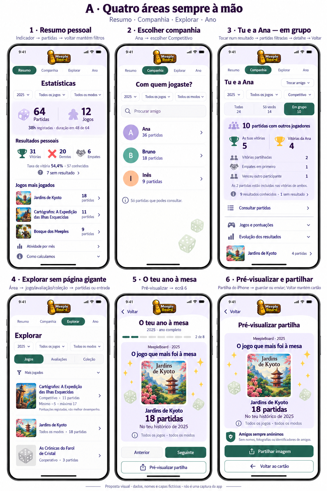
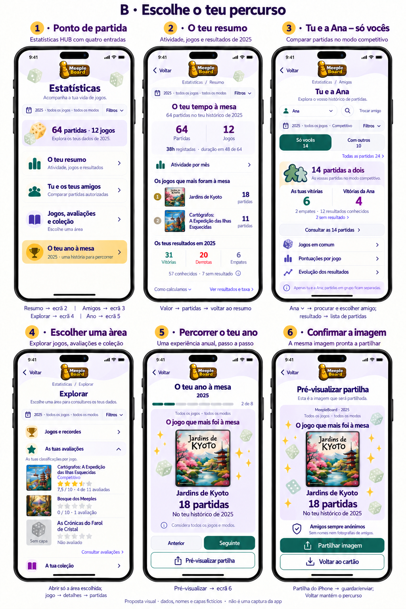

# Estatísticas — duas alternativas de organização

Estado: alternativa A aprovada em 08/10/2026; implementação inicial limitada ao Resumo, com aprovação visual no iPhone pendente. Ver `implementacao-estatisticas-resumo-a.md`.

Estado original da análise, 07/10/2026: Nenhum ecrã, contrato, cálculo, migração ou dado foi alterado. Inspeção dos dois repositórios; apenas documentação/mockups novos no frontend. A base habitual não foi consultada. As imagens são propostas com dados, pessoas, jogos e capas fictícios; não são capturas da aplicação nem dados de utilizadores.

## Problemas confirmados na implementação atual

- `StatisticsScreen.tsx`: os acessos a Companhia, Explorar e Ano aparecem depois do resumo, evolução, resultados, avaliação e jogos frequentes. Descobrir uma área exige percorrer conteúdo de outra.
- `CompanyScreen.tsx`: filtros precedem a escolha da pessoa; competitivo, cooperativo, jogos, evolução, pontuações e companhia frequente aparecem na mesma página longa. Muitas linhas têm o mesmo peso. Depois de escolher alguém, a hierarquia continua centrada em «Companhia», em vez da relação «Tu e a Ana».
- `ExploreScreen.tsx`: um único ecrã parametrizado lista detalhes de todos os jogos. Mínimo/máximo, taxas, cobertura e primeira partida repetem-se por jogo; as categorias não oferecem navegação local persistente.
- Filtros existem em vários componentes/estados locais. Recebem contexto pelas rotas e conservam-no no retorno dos suportes, mas não há um estado comum para mudar de área com a mesma seleção de forma previsível.
- `YearScreen.tsx`: já tem cartões e preview, mas a entrada está no fim do resumo e a composição conserva muito do padrão de consulta. Deve ter uma entrada evidente e um percurso visual próprio.
- `StatisticsExploreContracts.cs`: `PairRow` e o relatório não expõem o número de participantes. `OtherWin`/`OtherDraw` só identificam resultados de terceiros; não permitem concluir se uma partida teve apenas dois participantes. A distinção pedida exige extensão do contrato/agregação após aprovação, usando os participantes já guardados.

## A — Quatro áreas sempre à mão (recomendada)

Quatro separadores internos: **Resumo · Companhia · Explorar · Ano**. Permanecem acessíveis na consulta; não substituem os acessos globais da app. Ano abre o leitor próprio. Logótipo centrado e cabeçalho compacto. Com ampliação, separadores podem ocupar duas linhas sem encurtar rótulos.

1. **Resumo:** atividade, tempo/cobertura, resultados pessoais e três jogos frequentes com capas. Evolução mensal abre por acesso curto; a consulta dos meses continua textual. Avaliações e coleção saem desta página. Valores continuam tocáveis para os suportes.
2. **Companhia:** primeiro procurar/escolher amigo, com ranking autorizado. Selecionar Ana → «Tu e a Ana» → escolher modo/contexto → resultados → partidas → detalhe → regressar. Com todos os modos, mostrar acessos separados ao competitivo e cooperativo; selecionar um aplica explicitamente esse modo. Nunca somar resultados de equipa como se fossem confronto individual.
3. **Explorar:** escolhas visíveis Jogos, Avaliações e Coleção. Jogos mostram capa, nome, frequência e modo; detalhes/recordes abrem por jogo. Avaliações mostram apenas as próprias e cobertura. Coleção conserva estados, preços conhecidos e acessos, com os limites atuais de moeda/aquisição. Não repetir todos os indicadores por jogo na listagem.
4. **Ano:** escolha explícita do ano → cartões → pré-visualização da mesma imagem → folha de partilha → voltar ao cartão. Sem barra de consulta dentro do leitor; progressão, Anterior/Seguinte e fonte dos dados visíveis.

Resolve a descoberta das áreas e permite alternar entre resumo, pessoa e jogo numa ação. Custo: uma linha de navegação interna adicional; exige distinguir essa linha dos filtros e adaptá-la ao texto ampliado.

## B — Escolhe o teu percurso

Entrada curta com quatro acessos: **O teu resumo**, **Tu e os teus amigos**, **Jogos, avaliações e coleção**, **O teu ano à mesa**. Depois, um assunto por ecrã, com Voltar e origem visível. Filtros abrem num editor comum; resumo dos filtros ativos permanece no ecrã.

1. **Resumo:** entrada → resumo próprio → indicador/meses/jogo → partidas. Apenas atividade, frequência e resultados prioritários; explicações e taxa detalhada abrem à parte.
2. **Amigos:** entrada → escolher pessoa → «Tu e a Ana» → escolher Só vocês/Com outros → resultado → partidas. Trocar amigo acessível no cabeçalho do conteúdo, mantendo período/jogo/modo.
3. **Explorar:** diretório curto Jogos e recordes / As tuas avaliações / A tua coleção; abrir só a área escolhida. O mockup ilustra Avaliações com 7,5, zero e ausência distintos.
4. **Ano:** convite próprio na entrada → leitor imersivo → preview → partilha. Regresso retoma o ponto de partida e os seus filtros.

Resolve a sensação de uma página interminável e dá mais espaço ao conteúdo/teclado/ampliação. Custo: mudar de assunto implica regressar à entrada; há mais passos para alternar frequentemente entre amigo e jogo.

## Regras comuns e percursos preservados

- Período (semana/mês/ano/intervalo), GameId e modo têm um contexto de filtros comum na consulta, isolado por conta. Alterações explícitas ficam visíveis e aplicam-se aos indicadores daquela consulta. Aplicar/Limpar acessíveis; etiquetas com valores reais, nomes longos em várias linhas. Nada é escolhido silenciosamente para tornar os números mais atraentes.
- Amigo e contexto a dois/grupo pertencem à Companhia. Os suportes recebem todos os filtros, pessoa, contexto, métrica e bucket; regressar conserva seleção, secção aberta e posição. Trocar conta elimina o contexto anterior; pedidos antigos não podem substituir os atuais.
- O Ano indica «ano completo», conserva jogo/modo escolhidos e usa ano próprio. Sair restaura o período anterior da consulta, incluindo intervalo personalizado; não transforma silenciosamente um mês num ano.
- Só vocês: ambos participam e há exatamente dois participantes distintos **registados na partida**. Com outros: ambos participam e existem três ou mais. Todas agrega as duas situações e mostra a distribuição. Não contar convidados da sessão que não participaram na partida; não inferir grupo por vencedor, catálogo ou pontuação. Listas históricas incompletas/indisponíveis não são reconstruídas; indicar o limite do histórico.
- «As tuas vitórias» e «Vitórias da Ana» incluem partilhadas, preservando cálculos. A quantidade partilhada aparece separada com indicação curta de que está incluída em ambas. Empate entre ambos, empate com outros, outro vencedor e outro vencedor que partilhou vitória mantêm os respetivos suportes/detalhes. Não somar categorias sobrepostas para obter a amostra.
- Competitivo/Solo/cooperativo continuam distintos. Cooperativo mostra resultado da equipa e nunca escolhe vencedor individual. Solo não é um confronto com um amigo; se um filtro Solo chega à Companhia, explicar e permitir alteração explícita, sem mudar modo automaticamente.
- Amostra/conhecidos/sem resultado visíveis junto aos resultados. Resultados antigos por confirmar continuam separados e excluídos das taxas; sem inferências nem reclassificação. Duração ausente não é zero. Avaliação zero/meios pontos e pontuações zero/negativas mantidas. Mínimo/máximo não significam melhor desempenho.
- Recordes, evolução detalhada, comparações numéricas e fórmulas em detalhes/expansíveis. Não esconder a cobertura essencial dentro de «Como calculamos». Capas em proporção original, fallback no erro/ausência; nomes longos e texto ampliado com scroll. Áreas de toque ≥44 pt; controlos não dependem só da cor.
- Apenas partidas autorizadas e amigos aceites. Sem consulta ao histórico separado, diário, notas ou avaliações do amigo. Nomes permitidos apenas na consulta privada; imagens externas sempre sem nomes/avatares/IDs de amigos, com informação fixa e sem opção de desativar. Preview corresponde ao conteúdo e composição do ficheiro exportado.

## Dados ilustrativos coerentes

| Universo fictício | Contagens |
|---|---|
| Resumo pessoal 2025 | 64 partidas, 12 jogos; 38h de 48/64 com duração; 31 vitórias, 20 derrotas, 6 empates = 57 conhecidos; 7 sem resultado; taxa 54,4% (arredondamento visual) |
| Jogos frequentes | Jardins de Kyoto 18; Cartógrafos: A Expedição das Ilhas Esquecidas 11; Bosque dos Meeples 9 |
| Companhia, todos os modos | Ana 36; Bruno 18; Inês 9; contagens por pessoa podem sobrepor-se numa partida |
| Tu e Ana, competitivo | 24 conjuntas: 14 a dois + 10 em grupo |
| A mostra Em grupo | 10 partidas; tu 5 e Ana 4, incluindo 2 partilhadas; 1 empate e 1 vencedor externo; 9 conhecidos + 1 desconhecido |
| B mostra Só vocês | 14 partidas; tu 6, Ana 4 e 2 empates; 12 conhecidos + 2 desconhecidos; zero partilhadas |
| Avaliações ilustrativas | Cartógrafos média 7,5 de quatro avaliações próprias; Bosque avaliação zero; As Crónicas do Farol de Cristal não avaliado/sem capa |

A e B ilustram contextos diferentes identificados nos controlos; não comparar diretamente 5/4 em grupo com 6/4 a dois. Na implementação todos os indicadores devem ser calculados pela API no contexto selecionado; estes valores não serão semeados nem codificados no produto.

## Recomendação e próximo passo

Recomendo **A**, pela importância atribuída à Companhia e à exploração frequente: permite encontrar as quatro áreas sem scroll nem regressar sempre a um menu. Conserva a simplicidade de escolher a pessoa primeiro e usa expansão/detalhes para informação secundária. B é preferível se a prioridade for um percurso guiado de cada vez, com menos navegação permanente.

Após escolha, implementar primeiro navegação/filtros e Companhia. A distinção a dois/grupo exige estender agregações/contratos e suportes com contagem de participantes/contexto; os dados base já existem, sem necessidade prevista de migração para essa contagem. Validar SQL/API, privacidade e valores conhecidos exclusivamente em DeviceTests, depois confirmar composição no iPhone. Ainda não há aprovação destas propostas ou código implementado.

Mockups gerados com ferramenta incorporada `image_gen`; [prompt A](mockups/estatisticas/navegacao-v2/prompt-a.txt), [prompt B](mockups/estatisticas/navegacao-v2/prompt-b.txt), [afinação A](mockups/estatisticas/navegacao-v2/prompt-a-afinacao.txt), [afinação B](mockups/estatisticas/navegacao-v2/prompt-b-afinacao.txt) e [correção do percurso/privacidade B](mockups/estatisticas/navegacao-v2/prompt-b-correcao-percurso.txt). As imagens servem para escolher hierarquia/percursos; não comprovam medidas, acessibilidade ou rendering nativo. A representação das estrelas é ilustrativa: manter escala numérica 0–10, meios pontos e o valor exato da média, sem conversão para uma escala de cinco. Seguinte muda de cartão; só Pré-visualizar abre a prévia. A implementação da prévia reutilizará o próprio cartão para garantir a mesma imagem, não uma regeneração independente. Mantêm-se pendentes as confirmações anteriores de Solo empate/não definido, cooperativo, campanhas, autenticação e Jogar novamente.
